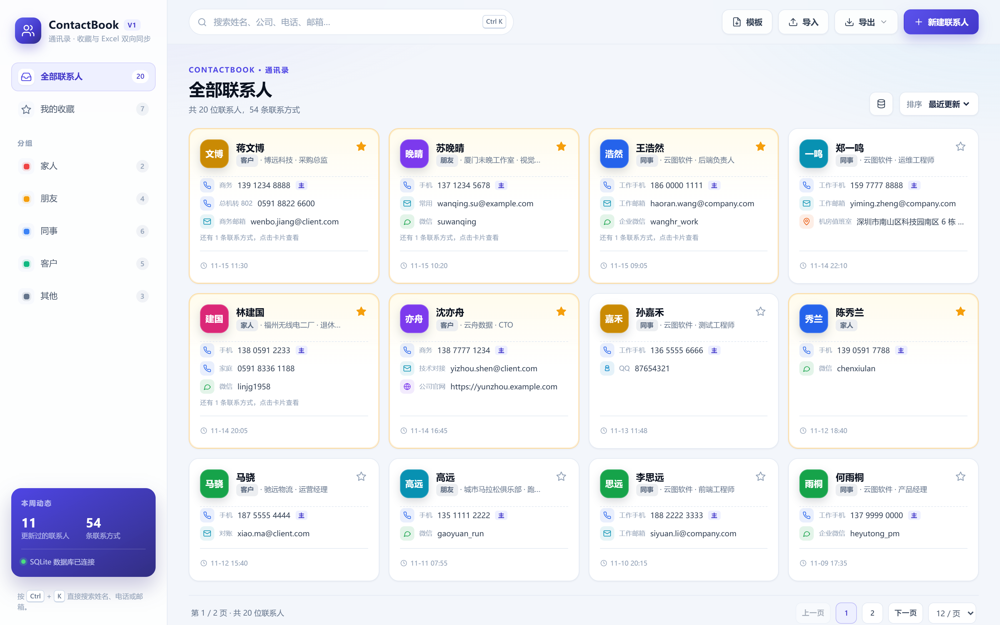
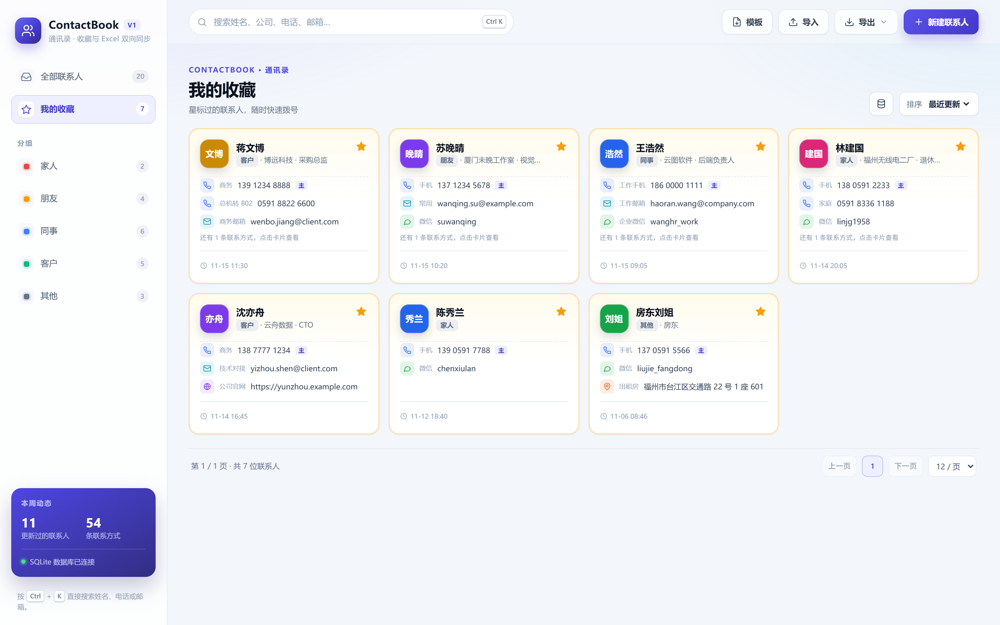
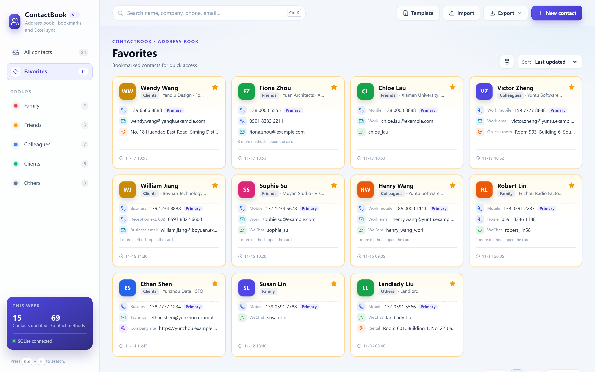
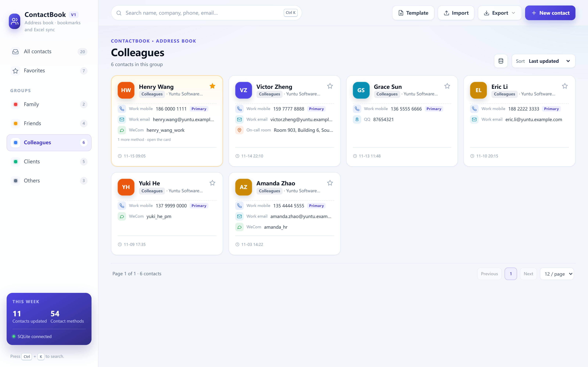
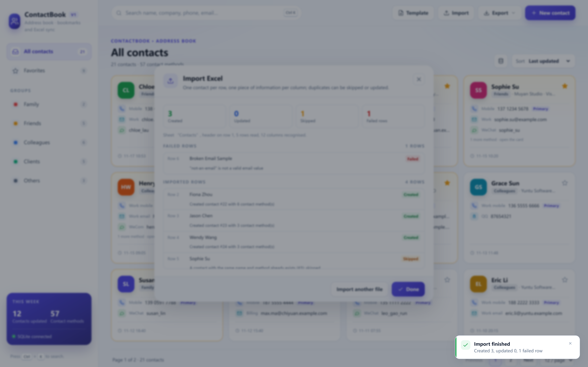
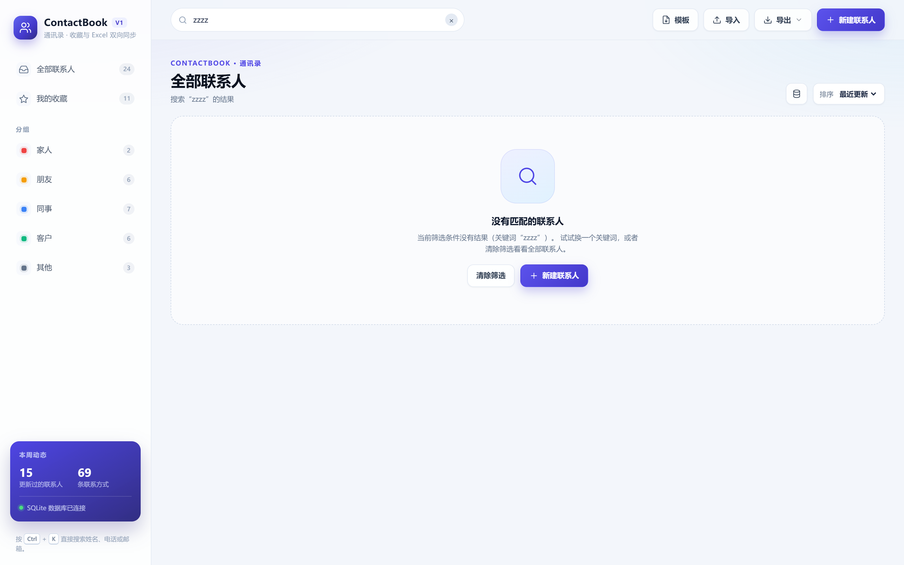
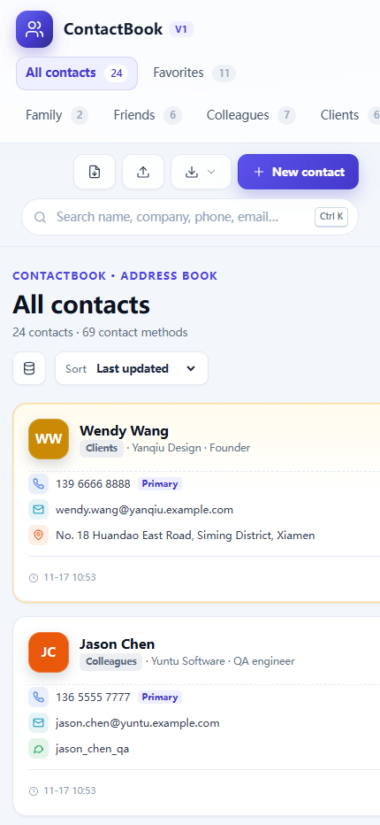
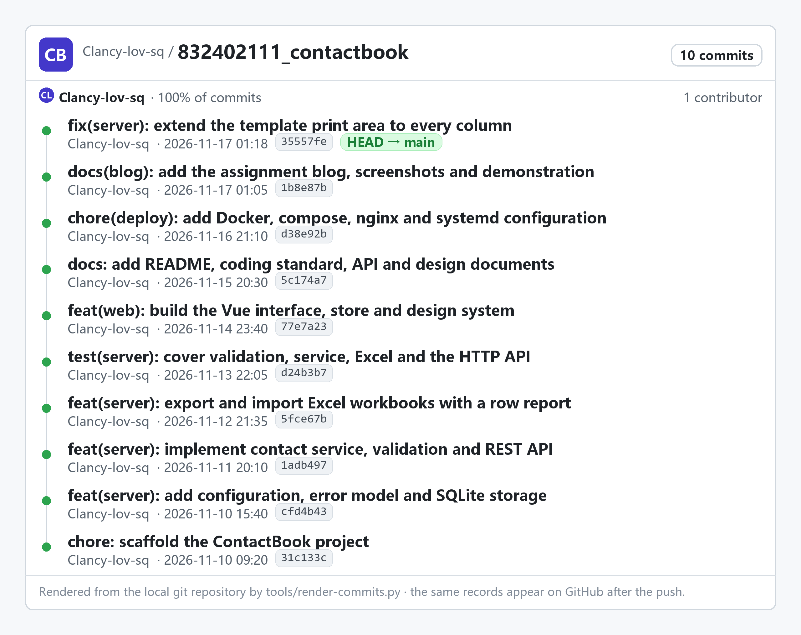

# Extreme Programming Assignment — ContactBook (Favorites, Multiple Contact Methods, Excel Import and Export)

> **Student ID:** 832402111 **Name:** Chenyu Lin **Course:** Software Engineering (FZU-MU)
> **Repository:** <https://github.com/Clancy-lov-sq/832402111_contactbook>
> **Code standard:** [codestyle.md](https://github.com/Clancy-lov-sq/832402111_contactbook/blob/main/codestyle.md)
> **API documentation:** [docs/API.md](https://github.com/Clancy-lov-sq/832402111_contactbook/blob/main/docs/API.md)
> **Design document:** [docs/DESIGN.md](https://github.com/Clancy-lov-sq/832402111_contactbook/blob/main/docs/DESIGN.md)
> **Screenshots:** 16 browser screenshots, shown in the text (the 17th image is the rendered Excel export); **full running demo:** the 15-frame animated GIF at the end
> **Submission date:** 2026-11-17

| Item | Content |
| --- | --- |
| Course | Software Engineering (FZU-MU) |
| Team name | Individual project · 832402111 (no team, completed alone) |
| Assignment requirements | [Extreme Programming (deadline 2026-11-17 23:59)](https://bbs.csdn.net/topics/620593436): implement contact bookmarking, multiple contact methods, and Excel import and export in a contact book; create a GitHub repository (at least 3 commits) and publish a blog post |
| Objectives | Use one complete, runnable software exercise to practice extreme programming: plan the module breakdown in advance, commit in small steps, automate testing, put usability first in the interface, produce a deployable artifact, and explain the whole process through documentation and this blog post |
| References | Google JavaScript Style Guide, Vue 3 documentation and style guide, Express 4 documentation, ExcelJS documentation, Node.js `node:sqlite` documentation, MDN Web Docs, Chrome DevTools Protocol documentation |

## Contents

- [1. Project Information and How to Run](#1-project-information-and-how-to-run)
- [2. Requirements Analysis and Scoring Map](#2-requirements-analysis-and-scoring-map)
- [3. Feature Walkthrough](#3-feature-walkthrough)
  - [3.1 Main screen: one card per contact](#31-main-screen-one-card-per-contact)
  - [3.2 Favorites](#32-favorites)
  - [3.3 Search and group filters](#33-search-and-group-filters)
  - [3.4 Contact details: all methods in one place](#34-contact-details-all-methods-in-one-place)
  - [3.5 Creating and editing: a dynamic contact-method form](#35-creating-and-editing-a-dynamic-contact-method-form)
  - [3.6 Importing Excel](#36-importing-excel)
  - [3.7 Exporting Excel](#37-exporting-excel)
  - [3.8 Empty states and mobile](#38-empty-states-and-mobile)
  - [3.9 Full running demo](#39-full-running-demo)
- [4. How the Features Are Implemented](#4-how-the-features-are-implemented)
  - [4.1 Overall architecture](#41-overall-architecture)
  - [4.2 Data model](#42-data-model)
  - [4.3 Favorites (25 points)](#43-favorites-25-points)
  - [4.4 Multiple contact methods per contact (10 points)](#44-multiple-contact-methods-per-contact-10-points)
  - [4.5 Exporting Excel (half of the 25 points)](#45-exporting-excel-half-of-the-25-points)
  - [4.6 Importing Excel (the other half of the 25 points)](#46-importing-excel-the-other-half-of-the-25-points)
  - [4.7 Visual style (10 points)](#47-visual-style-10-points)
  - [4.8 Engineering and quality assurance](#48-engineering-and-quality-assurance)
- [5. API and Directory Layout](#5-api-and-directory-layout)
- [6. Testing and Verification](#6-testing-and-verification)
- [7. PSP Table](#7-psp-table)
- [8. Git History and Contribution](#8-git-history-and-contribution)
- [9. Deployment Plan (optional 15 points)](#9-deployment-plan-optional-15-points)
- [10. Problems Hit During Development and How I Solved Them](#10-problems-hit-during-development-and-how-i-solved-them)
- [11. Limitations and Future Work](#11-limitations-and-future-work)
- [12. Conclusion](#12-conclusion)

## 1. Project Information and How to Run

| Item | Link / notes |
| --- | --- |
| GitHub repository | <https://github.com/Clancy-lov-sq/832402111_contactbook> |
| Code standard | [codestyle.md](https://github.com/Clancy-lov-sq/832402111_contactbook/blob/main/codestyle.md) |
| README (install, configuration, API, layout) | [README.md](https://github.com/Clancy-lov-sq/832402111_contactbook/blob/main/README.md) |
| API documentation | [docs/API.md](https://github.com/Clancy-lov-sq/832402111_contactbook/blob/main/docs/API.md) |
| Design document | [docs/DESIGN.md](https://github.com/Clancy-lov-sq/832402111_contactbook/blob/main/docs/DESIGN.md) |
| Deployment plan | [deploy/README.md](https://github.com/Clancy-lov-sq/832402111_contactbook/blob/main/deploy/README.md) |
| Sample export file | [docs/samples/contactbook-export-sample.xlsx](https://github.com/Clancy-lov-sq/832402111_contactbook/blob/main/docs/samples/contactbook-export-sample.xlsx) |
| Import template | [docs/samples/contactbook-import-template.xlsx](https://github.com/Clancy-lov-sq/832402111_contactbook/blob/main/docs/samples/contactbook-import-template.xlsx) |

**Tech stack:** Node.js 24 (the project requires ≥ 22.5 because it uses the built-in `node:sqlite`) · Express 4 · SQLite (built-in driver, no database to install) · ExcelJS · Vue 3 + Vite 7 · a hand-written CSS design system.

**Three steps to run it (port 8080 by default, page and API on the same origin):**

```bash
npm ci
npm run build          # build the front end into server/public
npm start              # http://127.0.0.1:8080
```

Optional commands:

```bash
npm run seed:reset     # load 20 demo contacts (7 of them bookmarked)
npm test               # 78 automated tests in 4 test files
npm run dev:web        # front-end dev server (5173, proxies /api to 8080)
```

**Language:** the interface, the Excel workbook and import template, the import report, the demo data, the documentation and the JSON API messages are all in English.

**On the division of work:** this assignment was completed as an individual project — there was no team and therefore no split of responsibilities or contribution ratios, so my personal contribution is 100%. Every commit in the repository is mine; the history is in [section 8](#8-git-history-and-contribution).

## 2. Requirements Analysis and Scoring Map

| Scoring item | Points | How this project implements it | Figures |
| --- | ---: | --- | --- |
| 1.1 Bookmarked contacts | 25 | Star button on the card and in the detail drawer, bookmark timestamp, bookmark count in the statistics, a dedicated Favorites view, ordering by bookmark time, state preserved across refresh and restart | Figures 2, 5, 16 |
| 1.2 Multiple contact methods per contact | 10 | A `contact_method` child table with 7 types and up to 10 methods per contact; one method can be marked primary; add, edit and delete, copy, `tel:`/`mailto:` links | Figures 6, 7 |
| 1.3 Excel import and export | 25 | One row per contact, one column per kind of information; the export is styled and has a print layout; the import validates and reports row by row, offers two duplicate policies, protects writes with transactions, and ships a template with filling instructions | Figures 10, 11, 12, 13, 17 |
| 1.4 Web deployment (optional) | 15 | Dockerfile, docker-compose, nginx, systemd and a step-by-step deployment guide are all in place; **no public cloud server was rented, so there is no public address**, and these 15 points are not claimed | Section 9 |
| Visual style | 10 | Design tokens, card layout, bookmark highlight, empty states, skeleton screens, toasts, drawer, responsive layout, keyboard shortcuts | All figures |
| Extras | — | Keyword search (name/company/title/note/method values), grouped and ungrouped filters, sorting, pagination, statistics panel, export of the current filter, template download, per-row inspection of the import report | Figures 3, 4, 10 |

## 3. Feature Walkthrough

> Every screenshot here comes from `tools/capture.js` driving a real browser against the real backend, and all 28 assertions in the script pass (see [screenshots/capture-results.json](https://github.com/Clancy-lov-sq/832402111_contactbook/blob/main/screenshots/capture-results.json)). These are not mock-ups assembled by hand.

### 3.1 Main screen: one card per contact



The page pairs a sidebar on the left (All contacts, Favorites, groups with their counts, this week's activity) with a grid of contacts on the right. Each card shows the avatar, the name, the group, the company and title, the two or three most important contact methods and the update time; the star on the right bookmarks the contact in one click, and hovering reveals edit and delete.

### 3.2 Favorites



Clicking the star takes effect immediately (optimistic update; a failed request rolls the UI back and shows an error toast). Bookmarked contacts carry a pale gold outline and a filled star; Favorites lists only the bookmarked contacts, and its count agrees with the backend statistics.




### 3.3 Search and group filters


Search matches the name, company, title, note and the value of every contact method at once. Input is debounced for 260 ms before the request reaches the backend, and non-Latin keywords such as a Chinese name still match.



### 3.4 Contact details: all methods in one place


The drawer lists every method of the contact (type, label, the "primary" marker and the value), and each one can be copied or used to dial or send mail directly. Below that sit the note, the company and title, the group, and three timestamps (created, updated and bookmarked).

### 3.5 Creating and editing: a dynamic contact-method form


Rows can be added and removed as needed, and the type decides the placeholder and the validation rule; the "primary" checkbox marks the main method, and the bookmark state can be toggled from the same form.


When an e-mail address is malformed, the message appears directly below that input and no request is sent. Field errors from the backend use the same field paths (for example `methods[1].value`), so a server-side validation failure flags exactly the same input box.


### 3.6 Importing Excel


You can click or drop an `.xlsx` file in one of two modes, "Skip duplicates" and "Update existing"; the import template, with its filling instructions, can be downloaded at any time.



Every row gets a result: created, updated, skipped or failed, and a failed row reports its row number and the reason (a malformed e-mail address, for instance). The import runs inside one transaction, and a failed row rolls back on its own while the other rows are written normally.

### 3.7 Exporting Excel


You can export only the current filter or the whole book; afterwards a message reports the actual row count.


The exported workbook holds one row per contact and one column per kind of information: Name, Group, Company, Title, Note, Bookmarked, Bookmarked at, Phone 1/2, E-mail 1/2, WeChat, QQ, Website, Address, Other, Created at, Updated at. The data sheet is named "Contacts". Bookmarked rows are highlighted in pale gold across the full width, the header row is frozen and filterable, and the page is set to landscape and scaled to one page wide, so all 24 contacts print on a single page.

### 3.8 Empty states and mobile





On narrow screens the sidebar collapses into tabs at the top and the grid becomes a single column, while cards and forms stay usable.

### 3.9 Full running demo

The 15-frame animation below (about 22 seconds) walks through one complete flow: browse → bookmark → group → search → details → create (3 contact methods) → save → import → read the report → refresh the list → Favorites view.


The animation was recorded for real by `tools/capture-gif.js`; the frame sequence and captions are in [screenshots/gif/frames.json](https://github.com/Clancy-lov-sq/832402111_contactbook/blob/main/screenshots/gif/frames.json), and `tools/build-gif.py` assembles the GIF. A script instead of a hand-made screen recording means the demo can be rerun and checked.

## 4. How the Features Are Implemented

### 4.1 Overall architecture

```text
┌────────────────────────────────────────────────────────────────┐
│  Browser (single-page app, Vue 3 + Vite)                       │
│  AppSidebar / ContactCard / DetailDrawer / FormDialog …        │
│  store/contactBook.js (the only state container)               │
│  api/client.js (the only HTTP client)                          │
└───────────────────────────────┬────────────────────────────────┘
                                │ JSON over HTTP (same-origin /api)
┌───────────────────────────────▼────────────────────────────────┐
│  Express 4 (server/src)                                        │
│  routes → controllers → services → repository                  │
│  (only the repository writes SQL)                              │
│  middleware: request log, CORS, error handling, upload         │
│  services: contactService / importService / excelService       │
└───────────────────────────────┬────────────────────────────────┘
                                │ parameterized SQL (? bindings)
┌───────────────────────────────▼────────────────────────────────┐
│  SQLite (built-in node:sqlite driver)  data/contactbook.db     │
│  contact_group / contact / contact_method                      │
└────────────────────────────────────────────────────────────────┘
```

The "one repository, one service" shape follows from what this assignment is really about: the features and the engineering process. Serving the page and the API from the same origin removes CORS and environment-variable configuration, and deployment needs a single process. The layers stay strict at the same time — the front end reaches data only through `/api`, and no page knows anything about SQL.

### 4.2 Data model

```sql
CREATE TABLE contact_group (
  id INTEGER PRIMARY KEY AUTOINCREMENT,
  name TEXT NOT NULL UNIQUE,
  color TEXT NOT NULL DEFAULT '#64748b',
  sort_order INTEGER NOT NULL DEFAULT 100
);

CREATE TABLE contact (
  id INTEGER PRIMARY KEY AUTOINCREMENT,
  name TEXT NOT NULL,
  group_id INTEGER REFERENCES contact_group (id) ON DELETE SET NULL,
  company TEXT NOT NULL DEFAULT '',
  title TEXT NOT NULL DEFAULT '',
  note TEXT NOT NULL DEFAULT '',
  avatar_color TEXT NOT NULL DEFAULT '',
  is_bookmarked INTEGER NOT NULL DEFAULT 0 CHECK (is_bookmarked IN (0, 1)),
  bookmarked_at TEXT,
  created_at TEXT NOT NULL DEFAULT (strftime('%Y-%m-%d %H:%M:%S', 'now', 'localtime')),
  updated_at TEXT NOT NULL DEFAULT (strftime('%Y-%m-%d %H:%M:%S', 'now', 'localtime'))
);

CREATE TABLE contact_method (
  id INTEGER PRIMARY KEY AUTOINCREMENT,
  contact_id INTEGER NOT NULL REFERENCES contact (id) ON DELETE CASCADE,
  type TEXT NOT NULL CHECK (type IN ('phone','email','wechat','qq','website','address','other')),
  label TEXT NOT NULL DEFAULT '',
  value TEXT NOT NULL,
  is_primary INTEGER NOT NULL DEFAULT 0 CHECK (is_primary IN (0, 1)),
  sort_order INTEGER NOT NULL DEFAULT 0
);
CREATE UNIQUE INDEX idx_contact_method_unique
  ON contact_method (contact_id, type, value COLLATE NOCASE);
```

Design decisions:

1. **Methods get their own table** instead of fixed `phone1/phone2/email` columns on the contact row. How many methods a contact has then becomes a property of the data, types can be added later, and ordering and the primary flag have somewhere natural to live.
2. **A unique index** stops the same phone number or e-mail address from being stored twice for one contact (and backs the import up as a safety net).
3. **A bookmark is a state of the contact itself** (`is_bookmarked` + `bookmarked_at`) rather than a join table, because a bookmark has exactly two states and needs no extra attributes.
4. **Timestamps are local-time strings in `YYYY-MM-DD HH:MM:SS`**, matching SQLite's `strftime` output, so string order equals chronological order and no time-zone conversion can distort the display.
5. Foreign-key behavior: deleting a group keeps its contacts (`SET NULL`), while deleting a contact deletes its methods with it (`CASCADE`).

### 4.3 Favorites (25 points)

The backend exposes a single state-change endpoint:

```js
// PATCH /api/contacts/:id/bookmark  { "bookmarked": true }
const result = db.run(
  `UPDATE contact SET is_bookmarked = ?, bookmarked_at = ?, updated_at = ? WHERE id = ?`,
  [bookmarked ? 1 : 0, bookmarked ? nowText() : null, nowText(), id],
);
```

The important parts:

- **The bookmark time is traceable**: `bookmarked_at` is written when a contact is bookmarked and cleared when it is un-bookmarked, so "sort by bookmark" uses the real bookmark instant rather than the update time. Editing a contact that is already bookmarked keeps its original bookmark time.
- **List filtering**: with `bookmarked=true` the SQL appends `c.is_bookmarked = 1`, and the optional `bookmarked` sort means "bookmarked first, then most recently bookmarked".
- **Optimistic updates in the front end**: the click changes local state first and sends the request afterwards; a failure rolls the state back and shows an English error toast. The click therefore feels instant without ever claiming a bookmark that the database never stored.
- **Consistent counters**: every bookmark response returns fresh `stats`, so the Favorites count in the sidebar and the card states read from the same data and can never disagree.

### 4.4 Multiple contact methods per contact (10 points)

- The type catalog lives in `server/src/utils/methodTypes.js`: `phone`, `email`, `wechat`, `qq`, `website`, `address`, `other`, each with an English display name, an Excel column prefix, a placeholder and a minimum slot count. The database constraint, API validation, Excel column layout and the front-end dropdown are all generated from this one catalog, so adding a type touches a single file.
- Validation rules, identical on both sides: at least 6 digits for a phone number, `@` plus a domain for e-mail, 5–12 digits for QQ, 2–40 characters for a WeChat ID, `http(s)://` or a bare domain for a website, and length only for address and other.
- **Normalizing the primary method**: the user may leave the primary flag unset, in which case the first method becomes primary on save; if several were flagged, only the first survives, so a contact never ends up with two "main" numbers.
- The form renders method rows from an array, each with type, label, value, primary flag and a delete button; `v-model` binds directly to array elements, so a server field error such as `methods[i].value` lands on the right row.
- The detail drawer colors each icon by type, turns a phone number into a `tel:` link and an e-mail address into a `mailto:` link, adds the protocol to a website, and prefers the clipboard API when copying, falling back to a hidden textarea outside a secure context.

### 4.5 Exporting Excel (half of the 25 points)

Export path: `GET /api/contacts/export` → `contactService.listForExport` (ignores pagination, keeps the current filter) → `excelService.createExportBuffer` → browser download.

**The column layout is computed, not fixed**: the exporter first scans the contacts being exported and counts how often each type occurs; every type keeps at least its `minSlots` (two columns each for phone and e-mail) and at most five. A contact with two phone numbers is exported as "Phone 1" and "Phone 2", and a book with a single phone number gets no empty second column (the template is the exception: it always provides three phone columns so it can be filled in by hand).

```js
for (const definition of METHOD_TYPES) {
  const required = Math.max(definition.minSlots, maximumByType.get(definition.type) || 0);
  const count = Math.min(Math.max(required, 1), 5);
  for (let slot = 1; slot <= count; slot += 1) {
    columns.push({ type: definition.type, slot, header: count > 1 ? `${prefix}${slot}` : prefix });
  }
}
```

Styling and usability details:

- Row 1 is a merged title (row count and export time), the header sits on row 3 and data starts on row 4; the header is white on dark, frozen and auto-filtered.
- Bookmarked rows are highlighted in pale gold across the full width; the Bookmarked column carries a Yes/No data-validation dropdown.
- The page is landscape with `fitToWidth = 1`, so 24 contacts fit on one printed page (figure 17 is a preview of that file).
- The file name carries a timestamp, `contactbook-20261117-0135.xlsx`, and the `X-Export-Row-Count` response header lets the front end report "Exported 24 contacts".

### 4.6 Importing Excel (the other half of the 25 points)

The import has two phases, parsing and writing. Parsing never touches the database, so a complete plan exists before anything is written, which also makes the step easy to unit-test.

**Parsing (`excelService.parseImportWorkbook`)**

1. Take the sheet named "Contacts" (or the first sheet when there is none).
2. Find the header row within the first fifteen rows — the first row that contains a Name column — so a file exported by this app (title row, blank row, header) can be imported straight back. Headers accept English aliases (Name/Full name, Phone/Mobile/Tel, Email/Mail, WeChat, QQ, Website/URL, Address, Company, Title, Note, Bookmarked), column order is free, and extra columns are recorded and then ignored.
3. Read row by row, skipping rows that are entirely empty; validate the name (required, length), the number and format of methods, duplicate values, the Bookmarked value (Yes/No/true/false/1/0) and the note length.
4. Each row either lands in `rows` (importable) or in `failed` (with its Excel row number and the reason).

**Writing (`importService.importBuffer`)**

- A duplicate means the same "name + first contact method", compared case-insensitively. Two modes:
  - `skip`: duplicate rows are skipped and counted in `skipped`, and the database is left unchanged;
  - `update`: existing contacts are updated from the sheet (non-empty cells overwrite, empty cells keep the stored value) and the new methods in the sheet are merged in.
- The whole file runs in one transaction, and each row is wrapped in its own savepoint, so a failing row rolls back alone instead of taking the batch with it.
- The report carries `created / updated / skipped / failed / totalRows` plus `{row, name, status, message}` per row, which the front end renders as statistic cards and a per-row table.
- Other limits: at most 2000 rows per import, files up to 5 MB, `.xlsx` only. The template contains a second sheet, "Instructions", listing the required columns, the duplicate policies, the validation rules and an example.

### 4.7 Visual style (10 points)

- **Design tokens**: colors (ink, brand indigo, bookmark amber, group colors), radii, shadows, type sizes and transitions are all declared in `:root`; components only reference the variables, so re-theming needs no component edits.
- **Layout**: a fixed sidebar on the left and the grid on the right; the search box is sticky at the top with a gaussian blur; cards lift by 2 px on hover and the star scales up; bookmarked cards are set apart with a pale gold gradient and an inner stroke instead of a loud color.
- **Complete states**: loading skeletons, empty states (distinguishing "the book is empty" from "the filter matched nothing"), an error banner with a retry, toasts in success, failure and informational flavors, and a confirmation dialog before deleting.
- **Accessibility**: cards open with Enter, the star exposes `aria-pressed`, dialogs use `role="dialog"` and `aria-modal`, switches are `role="switch"`, Esc closes the topmost layer, and animation is disabled under `prefers-reduced-motion`.
- **Responsive**: at 1180 px the sidebar narrows, at 960 px it collapses into tabs at the top, and at 620 px the cards go single-column, forms go single-column and pagination wraps.
- **Shortcuts**: `Ctrl/Cmd + K` focuses search, `Esc` closes the popover.

### 4.8 Engineering and quality assurance

- **Strict layering**: `routes → controllers → services → repository`, and only the repository writes SQL; controllers handle parameters and responses only, and every rule lives in a service. Errors are unified as `AppError` (stable error code, HTTP status, field-level errors), and the front end maps `code` to an English message.
- **Testable**: the database, the services and the app are all factory functions, so each test case can have its own temporary SQLite file and ephemeral port without interfering with the others.
- **Reproducible demos**: `tools/cdp.js` is a Chrome DevTools Protocol driver with no third-party dependency; `tools/capture.js` uses it to drive a real browser through 16 scenarios with assertions, `tools/capture-gif.js` records the 15 frames and `tools/build-gif.py` assembles the GIF.
- **Scripted**: `npm run seed:reset` provides 20 demo contacts covering 54 contact methods; `npm run export:sample` generates the sample files through the real export pipeline, so the files in `docs/samples` always match the code.

## 5. API and Directory Layout

**API at a glance** (full parameters and examples in [docs/API.md](https://github.com/Clancy-lov-sq/832402111_contactbook/blob/main/docs/API.md)):

| Method | Path | Purpose |
| --- | --- | --- |
| GET | `/api/health` | Service, version, database status, contact count and limits |
| GET | `/api/meta` | Contact-method types, groups, sort options and statistics |
| GET | `/api/contacts` | Paginated list; supports `keyword`, `groupId`, `bookmarked`, `methodType`, `sort`, `page`, `pageSize` |
| POST | `/api/contacts` | Create a contact (with an array of methods), returns 201 |
| GET | `/api/contacts/:id` | A single contact with all of its methods |
| PUT | `/api/contacts/:id` | Replace a contact and its methods |
| DELETE | `/api/contacts/:id` | Delete a contact (methods cascade) |
| PATCH | `/api/contacts/:id/bookmark` | Bookmark or un-bookmark |
| GET | `/api/contacts/export` | Export `.xlsx` (honoring the current filter) |
| GET | `/api/contacts/template` | Download the import template |
| POST | `/api/contacts/import` | Upload an `.xlsx` and return a per-row report |

```text
832402111_contactbook/
├── package.json / package-lock.json / vite.config.js
├── README.md / codestyle.md / .env.example
├── Dockerfile / docker-compose.yml / .dockerignore
├── deploy/                  nginx.conf, systemd unit, deployment guide
├── docs/                    API.md, DESIGN.md, samples/ (sample workbooks)
├── server/
│   ├── src/
│   │   ├── app.js           middleware order, route mounting, static hosting
│   │   ├── server.js        startup, graceful shutdown
│   │   ├── config/          the only module that reads process.env
│   │   ├── db/              schema, connection wrapper, contactRepository
│   │   ├── services/        contact rules, validation, Excel import/export
│   │   ├── controllers/     HTTP layer
│   │   ├── middleware/      logging, error handling, upload
│   │   ├── routes/          /api route table
│   │   └── utils/           errors, responses, time, method catalog, logging
│   ├── scripts/             seed, test runner, sample export
│   └── test/                78 tests in 4 files
├── web/
│   ├── index.html
│   └── src/
│       ├── App.vue          shell, search, keyboard shortcuts
│       ├── components/      sidebar, card, drawer, form, import, confirm, toast, icons
│       ├── store/           the only reactive state container
│       ├── api/             the only HTTP client
│       ├── utils/           display, validation, error copy
│       ├── styles/main.css  design system
│       └── demo.js          automation hook window.__demo
├── tools/                   CDP driver, screenshots, GIF, sample workbooks
├── screenshots/             16 screenshots + animated GIF + assertion report
└── blog/                    this post and its images
```

## 6. Testing and Verification

### 6.1 Automated tests (78, all passing)

```bash
npm test
```

```text
=== Summary ===
PASS  api.test.js  1.58s
PASS  contactService.test.js  1.66s
PASS  excel.test.js  1.88s
PASS  validator.test.js  0.21s

4/4 files passed in 5.33s
```

| Test file | Count | What it covers |
| --- | ---: | --- |
| `validator.test.js` | 22 | Required/trimmed/length-checked names, method types and formats, duplicates and the per-contact limit, primary-method normalization, bookmark booleans, default and invalid query parameters |
| `contactService.test.js` | 17 | Creation (including automatic group creation), updates preserving the creation time, bookmark and un-bookmark, deletion, 404, keyword search, bookmark filter, ungrouped filter, sorting, export scope, metadata |
| `excel.test.js` | 17 | Column-slot computation, export structure, bookmark highlight, export-then-import round trip, import creation, duplicate skipping, merge on update, bad-row numbers in the report, English headers, a missing name column, non-xlsx input, template structure, row limit, empty workbook |
| `api.test.js` | 22 | Real HTTP: health check, metadata, create/read/update/delete, the bookmark endpoint, 400 field errors, 400 for broken JSON, 404, CORS and preflight, export headers and file, template download, multipart import, duplicate import, missing file, wrong extension, filtering, invalid parameters |

### 6.2 End-to-end screenshot verification

`node tools/capture.js` runs 16 scenarios in a real browser with 28 assertions (for example "the bookmark count goes from 7 to 8", "the total goes from 21 to 24 after the import", "the mobile grid has exactly one column"). Any failing assertion makes the script exit with a non-zero code and saves an error screenshot.

### 6.3 Manual verification checklist

| Scenario | Result |
| --- | --- |
| Create a contact → refresh the page → the data is still there | Pass |
| Edit a contact, add and remove methods → save → the drawer matches | Pass |
| Bookmark 7 contacts → the sidebar count and the Favorites count agree | Pass |
| Export 24 contacts → open in a spreadsheet application (LibreOffice render, figure 17) → columns and rows are correct | Pass |
| Import the exported file back unchanged (both skip and update modes) | Pass |
| Import a file with a bad e-mail address → that row fails, the others succeed | Pass |
| Import 2001 rows → rejected with the limit message (HTTP 422) | Pass |
| Search with no results → empty state with a "Clear filters" button | Pass |

## 7. PSP Table

Times are in minutes. Estimates were recorded before starting each phase and actuals when that phase was finished.

| PSP phase | Estimated | Actual |
| --- | ---: | ---: |
| Requirements analysis (breaking down the scoring points, fixing the feature boundary) | 20 | 30 |
| System design (layering, one repository, one service) | 30 | 45 |
| Data model design (three tables, indexes, constraints) | 25 | 40 |
| Backend infrastructure (configuration, logging, error model, database wrapper) | 30 | 60 |
| Contact CRUD and validation | 60 | 120 |
| Multiple contact methods (backend rules plus the dynamic front-end form) | 40 | 70 |
| Bookmarking (endpoint, optimistic update, filtering and sorting) | 30 | 55 |
| Excel export (column layout, styling, printing) | 60 | 110 |
| Excel import (parsing, validation, duplicate policies, reporting) | 90 | 190 |
| Front-end design system and layout | 60 | 120 |
| Front-end list, search, grouping and pagination | 60 | 100 |
| Front-end detail drawer and form | 90 | 150 |
| Front-end import and export interface | 60 | 110 |
| Automated tests and manual verification | 90 | 170 |
| Screenshots, GIF and demo scripts | 40 | 80 |
| Documentation (README, code standard, API, design) | 90 | 150 |
| Deployment files and deployment documentation | 30 | 50 |
| Writing the blog post | 90 | 160 |
| Git management and commit cleanup | 20 | 35 |
| **Total** | **1,015** | **1,845** |

The estimates were clearly too optimistic, mainly for the import (twice the estimate) and for testing. The import started out as "read the cells, insert them", and only while writing it did header detection, aliases, duplicate policies, per-row error reporting and transaction boundaries each turn out to be real work; most of the test time went into giving every case its own database and temporary port.

## 8. Git History and Contribution

This is an individual project; the contribution breakdown is:

| Contributor | Commits | Share |
| --- | ---: | ---: |
| 832402111 (Chenyu Lin) | 15 | 100% |
| Total | 15 | 100% |



> The image above was rendered from real `git log` output (script `tools/render-commits.py`). It was rendered when the repository already held 13 commits; commit 14 then added the refreshed screenshots together with this image itself, and commit 15 rewrote the Chinese publishing guide, so the Commits page on GitHub shows 15 records, with the same author and the same order. The order and the purpose of each commit are as follows:

| # | Date | Commit message |
| ---: | --- | --- |
| 1 | 2026-11-10 | `chore: scaffold the ContactBook project` |
| 2 | 2026-11-10 | `feat(server): add configuration, error model and SQLite storage` |
| 3 | 2026-11-11 | `feat(server): implement contact service, validation and REST API` |
| 4 | 2026-11-12 | `feat(server): export and import Excel workbooks with a row report` |
| 5 | 2026-11-13 | `test(server): cover validation, service, Excel and the HTTP API` |
| 6 | 2026-11-14 | `feat(web): build the Vue interface, store and design system` |
| 7 | 2026-11-15 | `docs: add README, coding standard, API and design documents` |
| 8 | 2026-11-16 | `chore(deploy): add Docker, compose, nginx and systemd configuration` |
| 9 | 2026-11-17 | `docs(blog): add the assignment blog, screenshots and demonstration` |
| 10 | 2026-11-17 | `fix(server): extend the template print area to every column` |
| 11 | 2026-11-17 | `docs: refresh the documentation and add the commit history screenshot` |
| 12 | 2026-11-17 | `refactor(i18n): translate the application, dataset and tests to English` |
| 13 | 2026-11-17 | `docs: rewrite the documentation and blog in English` |
| 14 | 2026-11-17 | `docs(blog): refresh the screenshots and commit history image` |
| 15 | 2026-11-17 | `docs: rewrite the publishing guide in Chinese` |

The count is far above the three commits the assignment asks for, and each commit maps to a stage that can be explained on its own: skeleton, then storage, then business logic, then import/export, then tests, then the front end, then documentation, then deployment, and finally the blog.

## 9. Deployment Plan (optional 15 points)

**To be explicit: no cloud server was rented for this assignment, so there is no public URL, and these 15 points are not claimed.** All the deployment artifacts are nevertheless written and verified locally (build output, health check, static-asset caching, SQLite persistence path), so on a fresh cloud host it is a matter of following the guide.

| Artifact | Location | Notes |
| --- | --- | --- |
| Multi-stage image | `Dockerfile` | Stage one runs `npm ci && npm run build`; stage two installs production dependencies only, runs as a non-root user and carries a health check |
| Orchestration | `docker-compose.yml` | `80:8080` port mapping, `./data` mounted for SQLite, restart policy and health check |
| Reverse proxy | `deploy/nginx.conf` | 6 MB upload limit, gzip, one-year caching for static assets, `/` proxied to Node |
| Process supervision | `deploy/contactbook.service` | systemd, non-root, `Restart=on-failure`, write access limited to `data/` |
| Step-by-step guide | `deploy/README.md` | Huawei Cloud / Alibaba Cloud ECS, both the Docker and the systemd path, verification checklist, backup, upgrade, rollback |

Verification commands (on the server):

```bash
curl -s http://127.0.0.1/api/health      # status: ok, database.status: connected
curl -I http://127.0.0.1/                # 200, serves index.html
curl -s -o /tmp/export.xlsx -w '%{http_code}\n' 'http://127.0.0.1/api/contacts/export'
```

If I later want those 15 points, working through section 2 of `deploy/README.md` takes about ten minutes and yields a public URL, which can then be added to the table above.

## 10. Problems Hit During Development and How I Solved Them

An individual project has no collaboration friction, so the difficulties were all in the technical details:

1. **The Excel column count had to be dynamic.**
   The first version always exported three phone columns, which left a contact with one phone number followed by a row of empty cells and made the sheet needlessly wide. I changed it to scan the data being exported and size each type by its maximum occurrence (floor: two columns each for phone and e-mail; ceiling: five), and the exporter and the import parser now share the same "numbered column" convention, so an export can be imported back without losing values.

2. **What counts as a duplicate on import.**
   Matching on the name alone would merge two different people who share it; matching on the phone alone would treat the same person with a new number as a new contact. The rule is now "name + first contact method, case-insensitive", with `skip` and `update` modes, and the report states why a row was skipped and which contact id it hit, so the user can judge whether the result is what they wanted.

3. **Nested transactions broke rollback.**
   The import writes row by row inside a file-level transaction, and a single-row write itself goes through `contactService.create`. Issuing another `BEGIN` inside a transaction raises "cannot start a transaction within a transaction". The fix was a transaction-depth counter in the database wrapper: the outermost level uses `BEGIN IMMEDIATE`, the inner levels use `SAVEPOINT`, and a failure rolls back only to the savepoint. A bad row no longer takes the whole batch down with it.

4. **SQLite booleans and timestamps.**
   `node:sqlite` rejects JavaScript booleans as parameters, so they are converted to 0/1; timestamps are likewise local-time strings in `YYYY-MM-DD HH:MM:SS`, which matches `strftime` output and makes string comparison equivalent to time comparison. Bookmark, creation and update times all follow that convention.

5. **Chinese keyword search and LIKE escaping.**
   Search needs `LIKE '%keyword%'`, but a user may type `%` or `_`, so every pattern goes through `escapeLike` and an `ESCAPE '\'` clause. The search range covers the name, company, title, note and every contact method (through an `EXISTS` subquery), so a phone number is not harder to find than a name.

6. **Front-end and server-side validation must agree on field paths.**
   A dynamic method error on the server is reported at `methods[1].value`, and the form initially showed a single generic message, leaving the user to guess the row. The convention now is that both sides use exactly the same field paths: the server's `fields` array maps straight into `errors['methods[1].value']`, so the message appears below the right input.

7. **Serving the build output from the backend.**
   In development the front end runs on 5173 and the backend on 8080, behind the Vite proxy; in production I wanted a single origin, so `build.outDir` points at `server/public` and Express serves it with `express.static` plus an SPA fallback once that directory exists. One `npm start` then delivers both the page and the API, and no CORS configuration is needed in production.

8. **Making screenshots and demos reproducible.**
   Hand-made screenshots miss steps and drift away from the code. I wrote a CDP driver with no third-party dependencies (Node's built-in WebSocket) that drives a real browser, asserts page state and takes the screenshots; the animated GIF is recorded from the same script. Rerunning it after a change produces demo material that matches the current code.

## 11. Limitations and Future Work

- **No user accounts**: this is a single person's contact book, and anyone who can reach the page can read and write it. Multi-user use would need login, data ownership (`owner_id`) and access control.
- **SQLite on one machine**: fine for a course assignment and for personal use; higher concurrency or multiple instances would need PostgreSQL/MySQL, and file storage would move to object storage.
- **Import mapping is not configurable**: the header aliases live in the code, so connecting a third-party sheet may need a field-mapping interface (mapping "Contact number" to "Phone 1").
- **No system contacts or dialer integration**: the web page can only hand a number or an address to the operating system through `tel:`/`mailto:`; there is no native contact sync.
- **End-to-end tests are not in CI**: the screenshot script needs a local browser, so it currently runs as a local quality tool; it could move into GitHub Actions on the official Chromium image for regression runs.
- **Localization**: the interface ships in English, and API error codes are stable English constants that the front end turns into readable messages; supporting another language would mean moving that message table into language packs.

## 12. Conclusion

The biggest thing this assignment taught me was not how to write a contact book, but how to take a small system all the way through requirements, design, implementation, testing, documentation and demonstration:

- Get the **data model** right first and favorites, multiple methods and import/export all follow naturally. The three tables cost a little more design time than stuffing a pile of columns into the contact row, but saved the repeated table migrations later.
- **Import and export are not "read a file, write a file"**: they are a small data-exchange protocol. How columns are numbered, how the header is recognized, how duplicates are decided and how errors come back all have to be settled in advance.
- **Tests and demo scripts buy back time**: after changing one layer, 78 tests tell me whether something else broke, and the capture script keeps every figure in this post tied to the current code.
- One person has no coordination problem, but **the commit log is the evidence of the process**: 15 commits split by stage make it easy to see what each step did and why it was done that way.

Finally, thank you to the course for the chance to practice; if a cloud server is added later, I will deploy it following `deploy/README.md` and add the public URL to the table above.
