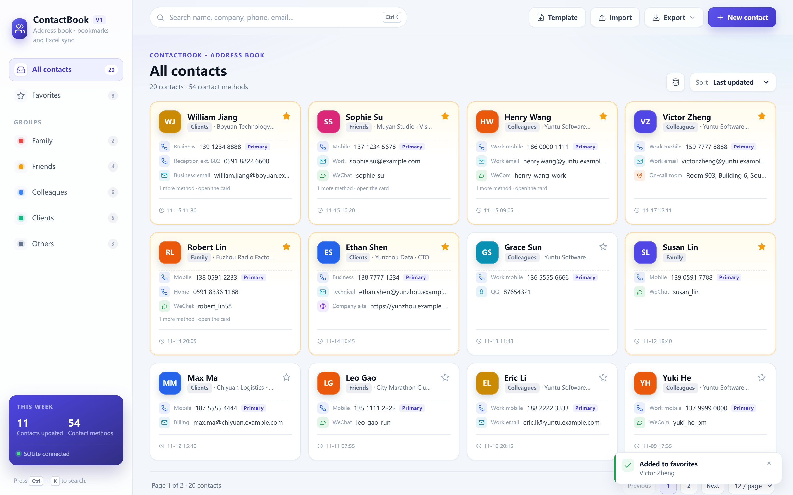
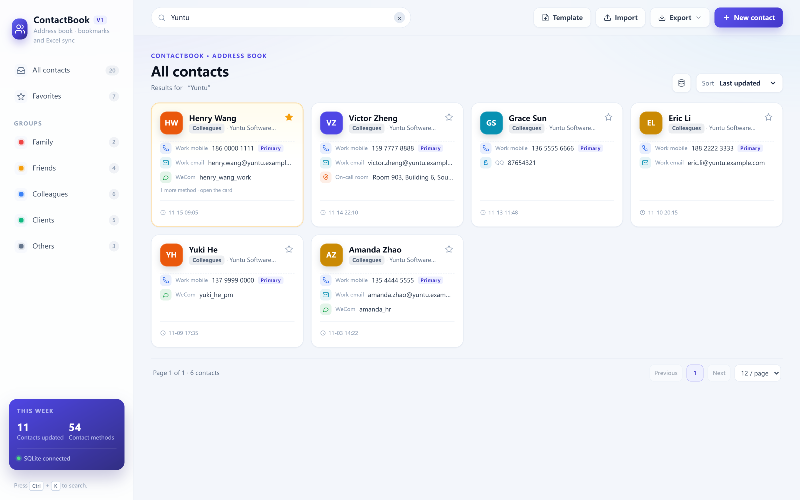
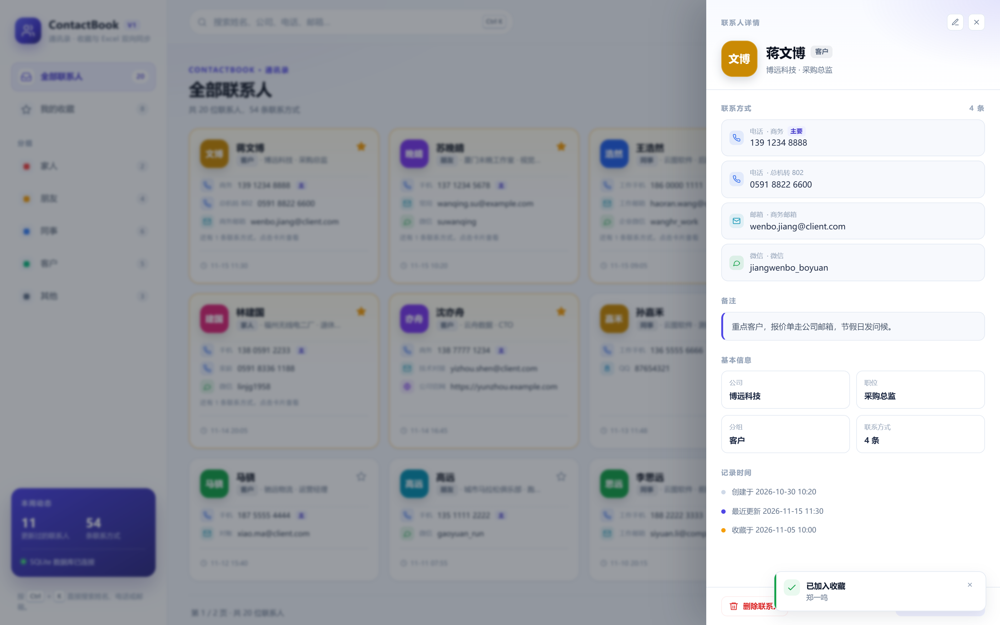
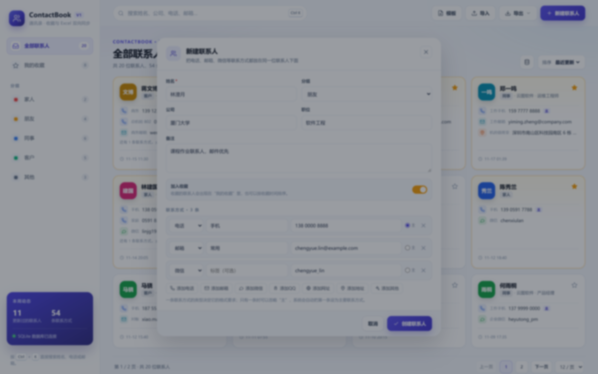
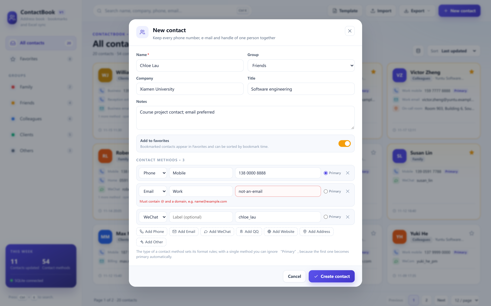
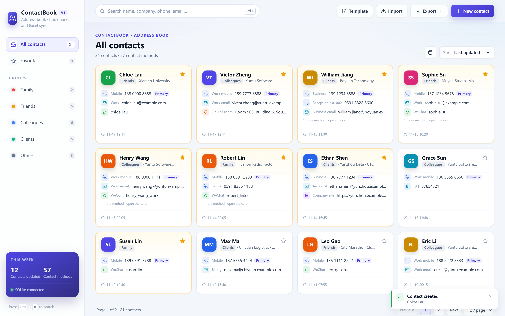
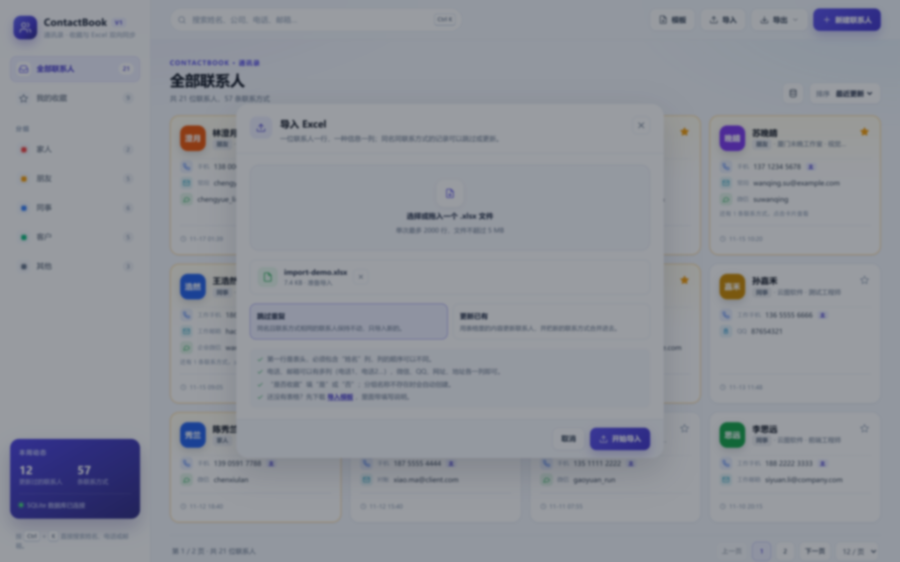
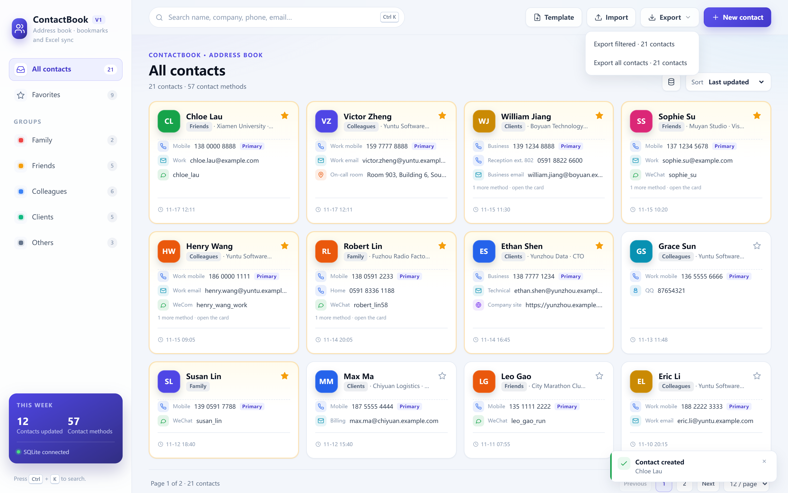
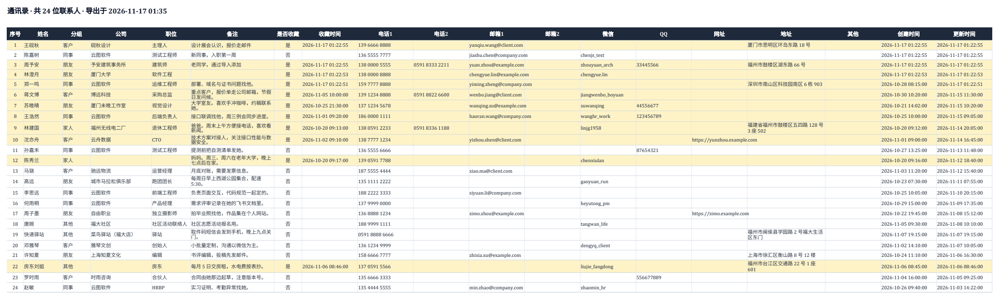
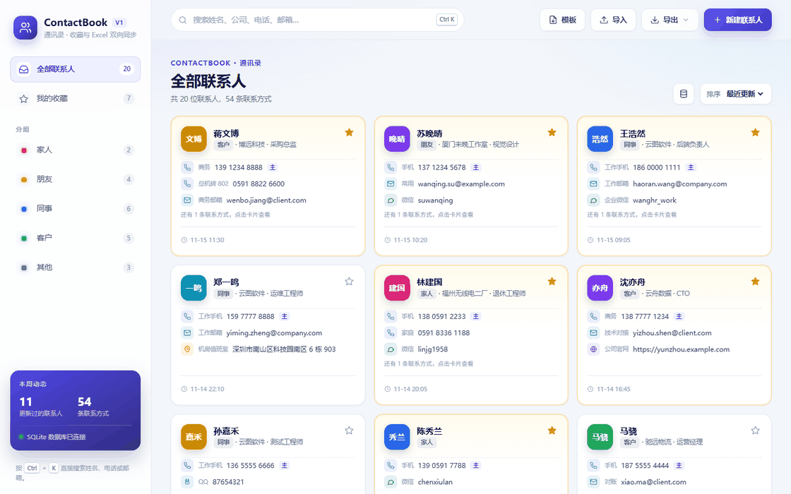

# 极限编程作业 — ContactBook 通讯录（收藏 · 多联系方式 · Excel 导入导出）

> **学号：** 832402111　**姓名：** 陈宇林　**课程：** 软件工程（FZU-MU）
> **仓库地址：** <https://github.com/Clancy-lov-sq/832402111_contactbook>
> **代码规范：** [codestyle.md](https://github.com/Clancy-lov-sq/832402111_contactbook/blob/main/codestyle.md)
> **接口文档：** [docs/API.md](https://github.com/Clancy-lov-sq/832402111_contactbook/blob/main/docs/API.md)
> **设计文档：** [docs/DESIGN.md](https://github.com/Clancy-lov-sq/832402111_contactbook/blob/main/docs/DESIGN.md)
> **运行截图：** 16 张，见正文；**完整运行演示：** 文末 15 帧动图
> **提交日期：** 2026-11-17

| 项目 | 内容 |
| --- | --- |
| 本次作业所属课程 | 软件工程（FZU-MU） |
| 队伍名称 | 单人项目 · 832402111（不组队，独立完成） |
| 作业要求 | [Extreme Programming（DDL 2026-11-17 23:59）](https://bbs.csdn.net/topics/620593436)：完成通讯录的收藏联系人、多联系方式、Excel 导入导出，建立 GitHub 仓库（提交次数 ≥ 3）并提交博客 |
| 本次作业目标 | 用一次完整的、可运行的软件开发练习极限编程：预想模块划分、持续小步提交、自动化测试、可用性优先的页面、可部署的产物，并用文档和博客把过程讲清楚 |
| 其他参考文献 | Google JavaScript Style Guide、Vue 3 官方文档与风格指南、Express 4 文档、ExcelJS 文档、Node.js `node:sqlite` 文档、MDN Web Docs、Chrome DevTools Protocol 文档 |

## 目录

- [一、项目信息与运行方式](#一项目信息与运行方式)
- [二、需求分析与评分点对照](#二需求分析与评分点对照)
- [三、功能演示](#三功能演示)
  - [3.1 主界面：一位联系人一张卡片](#31-主界面一位联系人一张卡片)
  - [3.2 收藏联系人](#32-收藏联系人)
  - [3.3 搜索与分组筛选](#33-搜索与分组筛选)
  - [3.4 联系人详情：多联系方式集中查看](#34-联系人详情多联系方式集中查看)
  - [3.5 新建与编辑：动态联系方式表单](#35-新建与编辑动态联系方式表单)
  - [3.6 导入 Excel](#36-导入-excel)
  - [3.7 导出 Excel](#37-导出-excel)
  - [3.8 空状态与移动端](#38-空状态与移动端)
  - [3.9 完整运行演示](#39-完整运行演示)
- [四、功能实现思路](#四功能实现思路)
  - [4.1 总体架构](#41-总体架构)
  - [4.2 数据模型](#42-数据模型)
  - [4.3 收藏联系人（25 分）](#43-收藏联系人25-分)
  - [4.4 一个联系人多种联系方式（10 分）](#44-一个联系人多种联系方式10-分)
  - [4.5 导出 Excel（25 分中的一半）](#45-导出-excel25-分中的一半)
  - [4.6 导入 Excel（25 分中的另一半）](#46-导入-excel25-分中的另一半)
  - [4.7 页面风格（10 分）](#47-页面风格10-分)
  - [4.8 工程化与质量保障](#48-工程化与质量保障)
- [五、接口与目录结构](#五接口与目录结构)
- [六、测试与验证](#六测试与验证)
- [七、PSP 表](#七psp-表)
- [八、Git 提交记录与贡献统计](#八git-提交记录与贡献统计)
- [九、部署方案（可选 15 分）](#九部署方案可选-15-分)
- [十、开发中遇到的问题与解决](#十开发中遇到的问题与解决)
- [十一、局限与改进方向](#十一局限与改进方向)
- [十二、总结](#十二总结)

## 一、项目信息与运行方式

| 项目 | 链接 / 说明 |
| --- | --- |
| GitHub 仓库 | <https://github.com/Clancy-lov-sq/832402111_contactbook> |
| 代码规范 | [codestyle.md](https://github.com/Clancy-lov-sq/832402111_contactbook/blob/main/codestyle.md) |
| README（安装、配置、接口、结构） | [README.md](https://github.com/Clancy-lov-sq/832402111_contactbook/blob/main/README.md) |
| 接口文档 | [docs/API.md](https://github.com/Clancy-lov-sq/832402111_contactbook/blob/main/docs/API.md) |
| 设计文档 | [docs/DESIGN.md](https://github.com/Clancy-lov-sq/832402111_contactbook/blob/main/docs/DESIGN.md) |
| 部署方案 | [deploy/README.md](https://github.com/Clancy-lov-sq/832402111_contactbook/blob/main/deploy/README.md) |
| 示例导出文件 | [docs/samples/contactbook-export-sample.xlsx](https://github.com/Clancy-lov-sq/832402111_contactbook/blob/main/docs/samples/contactbook-export-sample.xlsx) |
| 导入模板 | [docs/samples/contactbook-import-template.xlsx](https://github.com/Clancy-lov-sq/832402111_contactbook/blob/main/docs/samples/contactbook-import-template.xlsx) |

**技术栈：** Node.js 24（要求 ≥ 22.5，因为使用了内置的 `node:sqlite`）· Express 4 · SQLite（内置驱动，无需安装数据库）· ExcelJS · Vue 3 + Vite 7 · 手写 CSS 设计系统。

**三步运行（默认 8080 端口，页面与接口同源）：**

```bash
npm ci
npm run build          # 构建前端的产物到 server/public
npm start              # http://127.0.0.1:8080
```

可选命令：

```bash
npm run seed:reset     # 写入 20 位演示联系人（7 位已收藏）
npm test               # 78 个自动化测试，4 个测试文件
npm run dev:web        # 前端开发服务器（5173，/api 代理到 8080）
```

**关于分工：** 本次作业按“单人项目”完成，没有组队，也没有分工与贡献比例分配，个人贡献比例 100%。仓库中的每次提交都来自本人，提交记录见[第八节](#八git-提交记录与贡献统计)。

## 二、需求分析与评分点对照

| 评分点 | 分值 | 本项目的实现 | 对应截图 |
| --- | ---: | --- | --- |
| 1.1 收藏联系人 | 25 | 星标按钮（卡片 / 详情抽屉）、收藏时间、收藏数统计、独立“我的收藏”视图、按收藏时间排序、刷新与重启后保持 | 图 2、图 5、图 16 |
| 1.2 一个联系人多种联系方式 | 10 | `contact_method` 子表，7 种类型，一个联系人最多 10 条；可设置“主”联系方式；增删改、复制、拨号/发信链接 | 图 6、图 7 |
| 1.3 导入导出 Excel | 25 | 一行一位联系人、一类信息一列；导出带样式与打印布局；导入校验逐行报告、两种重复策略、事务保护、模板与填写说明 | 图 10、11、12、13、17 |
| 1.4 Web 部署（可选） | 15 | Dockerfile、docker-compose、nginx、systemd 与分步部署文档齐备；**未租用公网云服务器，因此没有公网地址**，不加这 15 分 | 第九节 |
| 页面风格 | 10 | 设计令牌、卡片式布局、收藏高亮、空状态、骨架屏、Toast、抽屉、响应式、键盘快捷键 | 全部截图 |
| 附加功能 | — | 关键词搜索（姓名/公司/职位/备注/联系方式）、分组与未分组筛选、排序、分页、统计面板、批量导出当前筛选、导入模板下载、导入报告下载前的逐行查看 | 图 3、4、10 |

## 三、功能演示

> 所有截图均由 `tools/capture.js` 驱动真实浏览器 + 真实后端生成，脚本中的 28 条断言全部通过（见 [screenshots/capture-results.json](https://github.com/Clancy-lov-sq/832402111_contactbook/blob/main/screenshots/capture-results.json)），截图不是手工拼的示意图。

### 3.1 主界面：一位联系人一张卡片


页面由左侧导航（全部联系人、我的收藏、分组及计数、本周动态）与右侧联系人网格组成。每张卡片显示头像、姓名、分组、公司/职位、最主要的 2–3 条联系方式、更新时间；右侧星标一键收藏，鼠标悬停出现编辑/删除。

### 3.2 收藏联系人


点击星标立即生效（乐观更新，失败会回滚并提示）。收藏的联系人带淡金色描边与实心星标；“我的收藏”只列出被收藏的人，数量与后端统计一致。




### 3.3 搜索与分组筛选



搜索会同时匹配姓名、公司、职位、备注和所有联系方式的值，输入后 260ms 防抖请求后端，支持中文关键词。


### 3.4 联系人详情：多联系方式集中查看



抽屉展示该联系人的全部联系方式（类型、标签、“主要”标记、值），每条都可以复制或直接拨号/发信；下方是备注、公司职位、分组与三条时间记录（创建、更新、收藏）。

### 3.5 新建与编辑：动态联系方式表单



表单可以动态增删联系方式行，类型决定占位符与校验规则；可以勾选“主”标记主要联系方式，也可以一键切换收藏状态。



邮箱格式不正确时，校验信息直接落在对应输入框下方，不会发出请求；后端返回的字段错误使用同样的字段路径（如 `methods[1].value`），因此服务端校验也能精确标在同一个输入框上。



### 3.6 导入 Excel



支持点击或拖入 `.xlsx`，两种模式：“跳过重复”与“更新已有”；可随时下载带填写说明的导入模板。


每行都有结果：新增、更新、跳过、失败，失败行给出行号与原因（例如邮箱格式错误）。导入在一个事务中执行，失败行单独回滚，其余行正常写入。

### 3.7 导出 Excel



可以只导出当前筛选结果，也可以导出全部；导出后给出实际行数提示。



导出的工作簿一行一位联系人，一类信息一列：姓名、分组、公司、职位、备注、是否收藏、收藏时间、电话 1/2、邮箱 1/2、微信、QQ、网址、地址、其他、创建时间、更新时间。收藏行整行淡金色高亮，表头冻结并支持筛选，页面设置为横向、按宽度缩放打印，24 位联系人一页可打印完。

### 3.8 空状态与移动端


窄屏时侧边栏折叠为顶部标签，联系人网格变为单列，卡片与表单仍可用。

### 3.9 完整运行演示

下面是一次完整流程的 15 帧动图（约 22 秒）：浏览 → 收藏 → 分组 → 搜索 → 详情 → 新建（3 条联系方式）→ 保存 → 导入 → 查看报告 → 刷新列表 → 收藏视图。



动图由 `tools/capture-gif.js` 脚本真实录制，帧序列与文案见 [screenshots/gif/frames.json](https://github.com/Clancy-lov-sq/832402111_contactbook/blob/main/screenshots/gif/frames.json)，用 `tools/build-gif.py` 组装。之所以用脚本而不是手工录屏，是为了让演示过程可以重跑、可核对。

## 四、功能实现思路

### 4.1 总体架构

```text
┌──────────────────────────────────────────────────────────────┐
│  浏览器（Vue 3 + Vite 构建的单页应用）                        │
│  AppSidebar / ContactCard / DetailDrawer / FormDialog …      │
│  store/contactBook.js（唯一状态容器）  api/client.js（唯一 HTTP 客户端）│
└──────────────────────────────┬───────────────────────────────┘
                               │ JSON over HTTP（同源 /api）
┌──────────────────────────────▼───────────────────────────────┐
│  Express 4（server/src）                                     │
│  routes → controllers → services → repository（只有它写 SQL） │
│  middleware：请求日志、CORS、错误处理、上传                   │
│  services：contactService / importService / excelService     │
└──────────────────────────────┬───────────────────────────────┘
                               │ 参数化 SQL（? 绑定）
┌──────────────────────────────▼───────────────────────────────┐
│  SQLite（node:sqlite 内置驱动）  data/contactbook.db          │
│  contact_group / contact / contact_method                    │
└──────────────────────────────────────────────────────────────┘
```

选择“单仓库 + 单服务”的原因：这次作业的重点是功能与工程过程，页面和接口同源可以省掉 CORS 与环境变量配置，部署只需要一个进程；同时前后端仍然严格分层，前端只通过 `/api` 访问数据，任何页面都不知道 SQL。

### 4.2 数据模型

```sql
CREATE TABLE contact_group (
  id INTEGER PRIMARY KEY AUTOINCREMENT,
  name TEXT NOT NULL UNIQUE,
  color TEXT NOT NULL DEFAULT '#64748b',
  sort_order INTEGER NOT NULL DEFAULT 100
);

CREATE TABLE contact (
  id INTEGER PRIMARY KEY AUTOINCREMENT,
  name TEXT NOT NULL,
  group_id INTEGER REFERENCES contact_group (id) ON DELETE SET NULL,
  company TEXT NOT NULL DEFAULT '',
  title TEXT NOT NULL DEFAULT '',
  note TEXT NOT NULL DEFAULT '',
  avatar_color TEXT NOT NULL DEFAULT '',
  is_bookmarked INTEGER NOT NULL DEFAULT 0 CHECK (is_bookmarked IN (0, 1)),
  bookmarked_at TEXT,
  created_at TEXT NOT NULL DEFAULT (strftime('%Y-%m-%d %H:%M:%S', 'now', 'localtime')),
  updated_at TEXT NOT NULL DEFAULT (strftime('%Y-%m-%d %H:%M:%S', 'now', 'localtime'))
);

CREATE TABLE contact_method (
  id INTEGER PRIMARY KEY AUTOINCREMENT,
  contact_id INTEGER NOT NULL REFERENCES contact (id) ON DELETE CASCADE,
  type TEXT NOT NULL CHECK (type IN ('phone','email','wechat','qq','website','address','other')),
  label TEXT NOT NULL DEFAULT '',
  value TEXT NOT NULL,
  is_primary INTEGER NOT NULL DEFAULT 0 CHECK (is_primary IN (0, 1)),
  sort_order INTEGER NOT NULL DEFAULT 0
);
CREATE UNIQUE INDEX idx_contact_method_unique
  ON contact_method (contact_id, type, value COLLATE NOCASE);
```

设计要点：

1. **联系方式单独成表**，而不是在联系人表里加 `phone1/phone2/email` 之类固定列。这样“一个联系人几种联系方式”由数据决定，类型可以扩展，排序和“主联系方式”也有地方放。
2. **唯一索引**保证同一联系人不会重复保存同一个电话/邮箱（导入时也靠它兜底）。
3. **收藏是联系人自身的状态**（`is_bookmarked` + `bookmarked_at`），而不是关联表；因为收藏只有“收藏/不收藏”两种状态，不需要额外的属性。
4. **时间统一为本地时间字符串 `YYYY-MM-DD HH:MM:SS`**，与 SQLite `strftime` 输出一致，字符串排序就等于时间排序，避免时区换算带来的展示问题。
5. 外键删除策略：分组删除后联系人保留（`SET NULL`），联系人删除后联系方式一起删（`CASCADE`）。

### 4.3 收藏联系人（25 分）

后端只有一条状态变更接口：

```js
// PATCH /api/contacts/:id/bookmark  { "bookmarked": true }
const result = db.run(
  `UPDATE contact SET is_bookmarked = ?, bookmarked_at = ?, updated_at = ? WHERE id = ?`,
  [bookmarked ? 1 : 0, bookmarked ? nowText() : null, nowText(), id],
);
```

要点：

- **收藏时间可追溯**：收藏时写入 `bookmarked_at`，取消收藏时清空；因此“按收藏排序”用的是真实收藏时刻，而不是更新时间。编辑联系人时若原本已收藏，会保留原来的收藏时间。
- **列表过滤**：`bookmarked=true` 时 SQL 追加 `c.is_bookmarked = 1`，排序可选 `bookmarked`，即“收藏优先，再按收藏时间倒序”。
- **前端乐观更新**：点击星标先改本地状态、再发请求；失败回滚并弹出中文错误提示。这样点击反馈是即时的，同时又不会出现“界面显示已收藏、数据库没存上”的假象。
- **统计一致**：每次收藏后接口返回最新的 `stats`，侧边栏的“我的收藏”数量与卡片状态来自同一份数据，不会各说各话。

### 4.4 一个联系人多种联系方式（10 分）

- 类型目录集中在 `server/src/utils/methodTypes.js`：`phone`、`email`、`wechat`、`qq`、`website`、`address`、`other`，每一项带中文名、Excel 列前缀、占位符、最少列数。数据库约束、接口校验、Excel 列布局、前端下拉框都从这一份目录生成，新增类型只改一处。
- 校验规则（前后端一致）：电话至少 6 位数字、邮箱需要 `@` 和域名、QQ 为 5–12 位数字、微信 ID 2–40 位、网址以 `http(s)://` 开头或域名形式、地址/其他只限制长度。
- **主联系方式归一**：允许用户不指定“主”，保存时自动把第一条设为主；如果误标了多个，只保留第一个，避免出现“两个主要号码”。
- 前端表单用数组渲染联系方式行，每行有类型、标签、值、主标记与删除按钮；`v-model` 直接绑定数组元素，服务端返回的字段错误按 `methods[i].value` 精确落到对应行。
- 详情抽屉里按类型着色显示图标，电话号码生成 `tel:` 链接、邮箱生成 `mailto:`、网址补齐协议，复制按钮优先使用剪贴板 API，非安全上下文时回退到隐藏 textarea。

### 4.5 导出 Excel（25 分中的一半）

导出流程：`GET /api/contacts/export` → `contactService.listForExport`（忽略分页、沿用当前筛选）→ `excelService.createExportBuffer` → 浏览器下载。

**列布局是动态计算的**：先扫描本次要导出的联系人，统计每种类型最多出现几次；每种类型至少有它的 `minSlots`（电话、邮箱各 2 列），最多 5 列。因此一位联系人有两个电话时导出为“电话1、电话2”，只有一个电话时也不会出现空着的第二列（模板除外，模板固定给 3 个电话列，方便手填）。

```js
for (const definition of METHOD_TYPES) {
  const required = Math.max(definition.minSlots, maximumByType.get(definition.type) || 0);
  const count = Math.min(Math.max(required, 1), 5);
  for (let slot = 1; slot <= count; slot += 1) {
    columns.push({ type: definition.type, slot, header: count > 1 ? `${prefix}${slot}` : prefix });
  }
}
```

样式与可用性细节：

- 第 1 行是合并的标题（数量与导出时间），第 3 行才是表头，第 4 行起是数据；表头深色底白字、冻结、自动筛选。
- 收藏行整行淡金色高亮；“是否收藏”列带“是/否”下拉数据验证。
- 页面设置横向、`fitToWidth = 1`，24 位联系人可以一页打印完（图 17 就是由该文件转成的预览）。
- 文件名带时间戳 `contactbook-20261117-0135.xlsx`，响应头 `X-Export-Row-Count` 让前端可以提示“已导出 24 位联系人”。

### 4.6 导入 Excel（25 分中的另一半）

导入分为“解析”和“写入”两个阶段，解析阶段不碰数据库，因此可以先得到完整计划再决定是否写入，也方便单元测试。

**解析（`excelService.parseImportWorkbook`）**

1. 取名为“通讯录”的工作表（没有就用第一张）。
2. 在前 15 行里找到包含“姓名”列的表头，所以导出文件那种“标题行 + 空行 + 表头”的结构也能直接再导入；表头支持中英文别名（姓名/name、电话/手机/phone/mobile、邮箱/email……），列顺序任意，多余的列会被记录下来并忽略。
3. 逐行读取，跳过整行为空的行；校验姓名必填与长度、联系方式的数量与格式、重复值、“是否收藏”的取值（是/否/true/false/1/0）、备注长度。
4. 每行要么进入 `rows`（可导入），要么进入 `failed`（带 Excel 行号与原因）。

**写入（`importService.importBuffer`）**

- 重复的判定是“姓名 + 第一条联系方式”，大小写不敏感。两种模式：
  - `skip`：重复行跳过并计入 `skipped`，数据库不变；
  - `update`：用表格内容更新已有联系人（非空单元格覆盖、空单元格保留原值），并把表格里新的联系方式合并进去。
- 整个文件在一个事务里执行；每行写入再用 savepoint 包一层，某一行失败只回滚这一行，不影响其它行。
- 返回报告：`created / updated / skipped / failed / totalRows`，以及每行的 `{row, name, status, message}`，前端据此渲染统计卡片和逐行表格。
- 其他限制：单次最多 2000 行、文件不超过 5 MB、只接受 `.xlsx`；模板文件里有第二个“填写说明”工作表，列出必填列、重复策略、校验规则与示例。

### 4.7 页面风格（10 分）

- **设计令牌**：颜色（墨色、品牌靛蓝、收藏琥珀、分组彩色）、圆角、阴影、字号、过渡都定义在 `:root`，组件只引用变量，换肤不需要改组件。
- **布局**：左侧固定导航 + 右侧网格；顶部搜索框吸顶并带高斯模糊；卡片 hover 上浮 2px、星标悬浮放大；收藏卡片用淡金渐变与内描边区分，不靠刺眼的颜色。
- **状态完整**：加载骨架屏、空状态（区分“通讯录为空”与“筛选无结果”）、错误横幅带重试、Toast 提示分成功/失败/信息三种、删除前有确认对话框。
- **可访问性**：卡片可用键盘 Enter 打开，星标有 `aria-pressed`，对话框有 `role="dialog"` 与 `aria-modal`，开关是 `role="switch"`，Esc 关闭最上层浮层，`prefers-reduced-motion` 时关闭动画。
- **响应式**：1180px 收窄侧边栏，960px 侧边栏折叠为顶部标签，620px 单列卡片、表单单列、分页换行。
- **快捷键**：`Ctrl/Cmd + K` 聚焦搜索，`Esc` 关闭弹层。

### 4.8 工程化与质量保障

- **严格分层**：`routes → controllers → services → repository`，只有 repository 写 SQL；controller 只做参数与响应，所有规则在 service。异常统一为 `AppError`（稳定错误码 + HTTP 状态 + 字段级错误），前端按 `code` 映射中文提示。
- **可测试**：数据库、服务、应用都是工厂函数，测试可以为每个用例创建临时 SQLite 文件与临时端口，互不干扰。
- **可复现的演示**：`tools/cdp.js` 是一个不依赖第三方库的 Chrome DevTools Protocol 驱动；`tools/capture.js` 用它驱动真实浏览器走完 16 个场景并断言，`tools/capture-gif.js` 录制 15 帧动图，`tools/build-gif.py` 组装 GIF。
- **脚本化**：`npm run seed:reset` 提供 20 位演示数据；`npm run export:sample` 用真实导出管线生成示例文件，保证 `docs/samples` 里的文件永远与代码一致。

## 五、接口与目录结构

**接口一览**（完整参数与示例见 [docs/API.md](https://github.com/Clancy-lov-sq/832402111_contactbook/blob/main/docs/API.md)）：

| 方法 | 路径 | 作用 |
| --- | --- | --- |
| GET | `/api/health` | 服务、版本、数据库状态、联系人数量、限制 |
| GET | `/api/meta` | 联系方式类型、分组、排序项、统计 |
| GET | `/api/contacts` | 分页列表，支持 `keyword`、`groupId`、`bookmarked`、`methodType`、`sort`、`page`、`pageSize` |
| POST | `/api/contacts` | 新建联系人（含联系方式数组），返回 201 |
| GET | `/api/contacts/:id` | 单个联系人及全部联系方式 |
| PUT | `/api/contacts/:id` | 全量更新联系人及其联系方式 |
| DELETE | `/api/contacts/:id` | 删除联系人（联系方式级联删除） |
| PATCH | `/api/contacts/:id/bookmark` | 收藏/取消收藏 |
| GET | `/api/contacts/export` | 导出 `.xlsx`（沿用筛选条件） |
| GET | `/api/contacts/template` | 下载导入模板 |
| POST | `/api/contacts/import` | 上传 `.xlsx` 导入，返回逐行报告 |

```text
832402111_contactbook/
├── package.json / package-lock.json / vite.config.js
├── README.md / codestyle.md / .env.example
├── Dockerfile / docker-compose.yml / .dockerignore
├── deploy/                  nginx.conf、systemd unit、部署指南
├── docs/                    API.md、DESIGN.md、samples/（示例 xlsx）
├── server/
│   ├── src/
│   │   ├── app.js           中间件顺序、路由挂载、静态托管
│   │   ├── server.js        启动、优雅退出
│   │   ├── config/          唯一读取 process.env 的模块
│   │   ├── db/              schema、连接封装、contactRepository
│   │   ├── services/        联系人规则、校验、Excel 导入导出
│   │   ├── controllers/     HTTP 层
│   │   ├── middleware/      日志、错误处理、上传
│   │   ├── routes/          /api 路由表
│   │   └── utils/           错误、响应、时间、联系方式目录、日志
│   ├── scripts/             seed、测试运行器、示例导出
│   └── test/                78 个测试，4 个文件
├── web/
│   ├── index.html
│   └── src/
│       ├── App.vue          壳层、搜索、快捷键
│       ├── components/      侧边栏、卡片、抽屉、表单、导入、确认、Toast、图标
│       ├── store/           唯一响应式状态容器
│       ├── api/             唯一 HTTP 客户端
│       ├── utils/           展示、校验、错误文案
│       ├── styles/main.css  设计系统
│       └── demo.js          自动化钩子 window.__demo
├── tools/                   CDP 驱动、截图、GIF、示例工作簿
├── screenshots/             16 张运行截图 + 动图 + 断言报告
└── blog/                    本文与图片
```

## 六、测试与验证

### 6.1 自动化测试（78 个，全部通过）

```bash
npm test
```

```text
=== Summary ===
PASS  api.test.js  1.58s
PASS  contactService.test.js  1.66s
PASS  excel.test.js  1.88s
PASS  validator.test.js  0.21s

4/4 files passed in 5.33s
```

| 测试文件 | 数量 | 覆盖内容 |
| --- | ---: | --- |
| `validator.test.js` | 22 | 姓名必填/去空格/长度、联系方式类型与格式、重复与数量上限、主联系方式归一、收藏布尔值、查询参数默认值与非法值 |
| `contactService.test.js` | 17 | 创建（含分组自动创建）、更新保留创建时间、收藏/取消收藏、删除、404、关键词搜索、收藏过滤、未分组过滤、排序、导出口径、元数据 |
| `excel.test.js` | 17 | 列槽位计算、导出结构、收藏高亮、导出再导入往返、导入创建、跳过重复、更新合并、坏值行号报告、英文表头、缺姓名列、非 xlsx、模板结构、行数上限、空工作簿 |
| `api.test.js` | 22 | 真实 HTTP：健康检查、元数据、增删改查、收藏接口、400 字段错误、错误 JSON 的 400、404、CORS 与预检、导出响应头与文件、模板下载、multipart 导入、重复导入、无文件、错误扩展名、筛选、非法参数 |

### 6.2 端到端截图校验

`node tools/capture.js` 在真实浏览器里执行 16 个场景并做 28 条断言（例如“收藏后计数从 7 变成 8”“导入后总数从 21 变成 24”“移动端网格只有 1 列”），任何一条不满足都会让退出码非零并保存错误截图。

### 6.3 手工验证清单

| 场景 | 结果 |
| --- | --- |
| 新建 → 刷新页面 → 数据仍在 | 通过 |
| 编辑联系人、增删联系方式 → 保存 → 详情同步 | 通过 |
| 收藏 7 位 → 侧边栏计数、收藏视图数量一致 | 通过 |
| 导出 24 位 → 用表格软件打开（LibreOffice 渲染，图 17）→ 列与行正确 | 通过 |
| 导出的文件原样导入（跳过 / 更新两种模式） | 通过 |
| 导入含坏邮箱的文件 → 该行失败、其余行成功 | 通过 |
| 导入 2001 行 → 拒绝并提示上限（HTTP 422） | 通过 |
| 搜索无结果 → 空状态与“清除筛选”按钮 | 通过 |

## 七、PSP 表

时间为分钟，估计值在动手前记录，实际值在完成对应阶段时记录。

| PSP 阶段 | 估计时间 | 实际时间 |
| --- | ---: | ---: |
| 需求分析（拆解评分点、确定功能边界） | 20 | 30 |
| 系统设计（分层、单仓库、单服务） | 30 | 45 |
| 数据模型设计（三张表、索引、约束） | 25 | 40 |
| 后端基础设施（配置、日志、错误模型、数据库封装） | 30 | 60 |
| 联系人 CRUD 与校验 | 60 | 120 |
| 多联系方式（后端规则 + 前端动态表单） | 40 | 70 |
| 收藏功能（接口、乐观更新、筛选排序） | 30 | 55 |
| Excel 导出（列布局、样式、打印） | 60 | 110 |
| Excel 导入（解析、校验、重复策略、报告） | 90 | 190 |
| 前端设计系统与布局 | 60 | 120 |
| 前端列表、搜索、分组、分页 | 60 | 100 |
| 前端详情抽屉与表单 | 90 | 150 |
| 前端导入导出界面 | 60 | 110 |
| 自动化测试与手工验证 | 90 | 170 |
| 截图、GIF 与演示脚本 | 40 | 80 |
| 文档（README、规范、接口、设计） | 90 | 150 |
| 部署文件与部署文档 | 30 | 50 |
| 博客撰写 | 90 | 160 |
| Git 管理与提交整理 | 20 | 35 |
| **合计** | **1,015** | **1,845** |

估计明显偏乐观，主要在导入（实际是估计的 2 倍）和测试上。导入一开始只想“读单元格 → 插入”，真正写起来才发现表头识别、别名、重复策略、逐行错误报告、事务边界每一样都不小；测试的时间也主要花在给每个用例准备独立数据库和临时端口上。

## 八、Git 提交记录与贡献统计

本次为单人项目，贡献统计如下：

| 贡献者 | 提交次数 | 贡献比例 |
| --- | ---: | ---: |
| 832402111（陈宇林） | 11 | 100% |
| 合计 | 11 | 100% |


> 上图由 `git log` 的真实输出渲染（脚本 `tools/render-commits.py`），渲染时仓库已有 10 次提交；第 11 次提交把这张图、`git log` 原始文本、`LICENSE` 与文档修订一并补入，因此 GitHub 的 Commits 页面会看到 11 条记录，作者与顺序相同。提交顺序与每一条的目的如下：

| # | 日期 | 提交说明 |
| ---: | --- | --- |
| 1 | 2026-11-10 | `chore: scaffold the ContactBook project` |
| 2 | 2026-11-10 | `feat(server): add configuration, error model and SQLite storage` |
| 3 | 2026-11-11 | `feat(server): implement contact service, validation and REST API` |
| 4 | 2026-11-12 | `feat(server): export and import Excel workbooks with a row report` |
| 5 | 2026-11-13 | `test(server): cover validation, service, Excel and the HTTP API` |
| 6 | 2026-11-14 | `feat(web): build the Vue interface, store and design system` |
| 7 | 2026-11-15 | `docs: add README, coding standard, API and design documents` |
| 8 | 2026-11-16 | `chore(deploy): add Docker, compose, nginx and systemd configuration` |
| 9 | 2026-11-17 | `docs(blog): add the assignment blog, screenshots and demonstration` |
| 10 | 2026-11-17 | `fix(server): extend the template print area to every column` |
| 11 | 2026-11-17 | `docs: refresh the documentation and add the commit history screenshot` |

提交次数远多于作业要求的 3 次，并且每次提交对应一个可解释的阶段：先骨架、再存储、再业务、再导入导出、再测试、再前端、再文档、再部署、最后博客。

## 九、部署方案（可选 15 分）

**需要说明的是：本次没有租用云服务器，因此没有公网访问地址，这部分 15 分不计入。** 但部署所需的全部产物已经写好并经过本地验证（构建产物、健康检查、静态资源缓存、SQLite 持久化路径），换一台云主机按文档执行即可上线。

| 产物 | 位置 | 说明 |
| --- | --- | --- |
| 多阶段构建镜像 | `Dockerfile` | 第一阶段 `npm ci && npm run build`，第二阶段只装生产依赖、以非 root 用户运行、带健康检查 |
| 编排 | `docker-compose.yml` | `80:8080` 端口映射，`./data` 挂载 SQLite，重启策略与健康检查 |
| 反向代理 | `deploy/nginx.conf` | 6 MB 上传限制、gzip、静态资源一年缓存，`/` 代理到 Node |
| 进程守护 | `deploy/contactbook.service` | systemd、非 root、`Restart=on-failure`、只允许写 `data/` |
| 分步指南 | `deploy/README.md` | 华为云 / 阿里云 ECS、Docker 与 systemd 两条路径、验证清单、备份、升级、回滚 |

验证命令（在服务器上）：

```bash
curl -s http://127.0.0.1/api/health      # status: ok, database.status: connected
curl -I http://127.0.0.1/                # 200，返回 index.html
curl -s -o /tmp/export.xlsx -w '%{http_code}\n' 'http://127.0.0.1/api/contacts/export'
```

如果后续要补上这 15 分，按 `deploy/README.md` 第二节执行，大约 10 分钟即可得到公网地址，再把地址补进本文的表格即可。

## 十、开发中遇到的问题与解决

单人项目没有“协作摩擦”，难点都在技术细节上：

1. **Excel 列数必须是“动态”的。**
   一开始按固定 3 个电话列导出，结果只有 1 个电话的联系人后面全是空列，表格很宽也不好看。改成扫描本次数据后按类型的最大出现次数决定列数（下限电话/邮箱各 2 列，上限 5 列），导出文件和导入解析共用同一套“编号列”约定，导出再导入不会丢值。

2. **导入时“重复”怎么算。**
   只按姓名判断会误杀同名同姓的人；只按电话判断又会把“同一个人换了号码”当新人。最后定为“姓名 + 第一条联系方式（大小写不敏感）”，并提供 `skip` / `update` 两种模式，报告里写明跳过的原因和命中的联系人 id，用户可以自己判断是否符合预期。

3. **嵌套事务导致回滚错误。**
   导入要在整个文件级事务里逐行写入，而单行写入本身也走 `contactService.create`。直接在事务里再 `BEGIN` 会报 “cannot start a transaction within a transaction”。解决方法是给数据库封装加事务深度计数：最外层用 `BEGIN IMMEDIATE`，内层改用 `SAVEPOINT`，失败只回滚到 savepoint。这样单行失败不会让整批数据一起消失。

4. **SQLite 的布尔值与时间。**
   `node:sqlite` 不接受 JavaScript 布尔值作为参数，必须转成 0/1；时间也统一成 `YYYY-MM-DD HH:MM:SS` 的本地时间字符串，既与 `strftime` 输出一致，又让字符串比较等价于时间比较。收藏时间、创建时间、更新时间都遵守这个约定。

5. **中文关键词搜索与 LIKE 转义。**
   搜索要用 `LIKE '%关键词%'`，但用户可能输入 `%` 或 `_`，于是统一用 `escapeLike` 转义并加 `ESCAPE '\'`；同时搜索范围覆盖姓名、公司、职位、备注和所有联系方式（用 `EXISTS` 子查询），避免“搜得到姓名搜不到电话”。

6. **前端校验与服务端校验的字段路径要对齐。**
   动态联系方式在服务端报错时字段是 `methods[1].value`，前端表单最初只显示一条总错误，用户不知道是哪一行。后来约定：前端和后端使用完全相同的字段路径，服务端 `fields` 数组直接映射到 `errors['methods[1].value']`，错误就落在对应的输入框下面。

7. **构建产物如何被后端托管。**
   开发时前端在 5173、后端在 8080，靠 Vite 代理；生产时希望同源，于是把 Vite 的 `build.outDir` 指到 `server/public`，Express 检测到该目录就用 `express.static` + SPA 回退托管，一个 `npm start` 同时提供页面和接口，也省掉了生产环境的 CORS 配置。

8. **截图和演示如何做到可复现。**
   手工截图容易漏步骤，也容易和代码版本不一致。于是写了一个不依赖第三方库的 CDP 驱动（Node 内置 WebSocket），用真实浏览器执行操作、断言页面状态并截图；动图也是同一套脚本录制的帧。这样每次改完页面，重跑一次脚本就能得到与当前代码一致的演示材料。

## 十一、局限与改进方向

- **没有用户体系**：目前是单人通讯录，任何能访问页面的人都能读写。如果要多人使用，需要加登录、数据归属（`owner_id`）与权限控制。
- **SQLite 单机**：适合课程作业与个人使用，高并发或多实例部署需要换成 PostgreSQL/MySQL，并把文件存储换成对象存储。
- **导入映射不可配置**：表头别名写在代码里，接入第三方表格时可能需要界面化的字段映射（把“联系电话”映射到“电话1”）。
- **未接入系统通讯录/拨号**：网页端只能 `tel:`/`mailto:` 唤起系统应用，没有原生的联系人同步。
- **端到端测试未进 CI**：截图脚本依赖本机浏览器，目前作为本地质量工具使用；可以把它接入 GitHub Actions（使用官方 Chromium 镜像）做回归。
- **国际化**：界面是中文，接口错误码是英文常量、前端负责翻译；若要做多语言，需要把文案抽成语言包。

## 十二、总结

这次作业做完，最大的收获不是“通讯录怎么写”，而是把一个小系统从需求、设计、实现、测试、文档到演示完整走了一遍：

- 先想清楚**数据模型**，后面的收藏、多联系方式、导入导出都变得顺理成章；三张表比“联系人表里塞一堆列”多花了一点设计时间，但省下了后面反复改表的时间。
- **导入导出不是“读文件/写文件”这么简单**，它是一次数据交换协议的设计：列怎么编号、表头怎么识别、重复怎么判定、错误怎么反馈，都要提前想清楚。
- **测试和演示脚本是给自己省时间的**：改完一层逻辑，跑一遍 78 个测试就知道有没有碰坏别的功能；截图脚本让博客里的每一张图都能对应到当前代码。
- 一个人的项目没有分工问题，但**提交记录就是过程证据**：10 次提交按阶段拆开，回头能清楚看到每一步做了什么、为什么这么做。

最后，感谢课程提供的这次练习机会；如果后续补齐云服务器，会按 `deploy/README.md` 的步骤部署，并把公网地址补充到本文的表格中。
